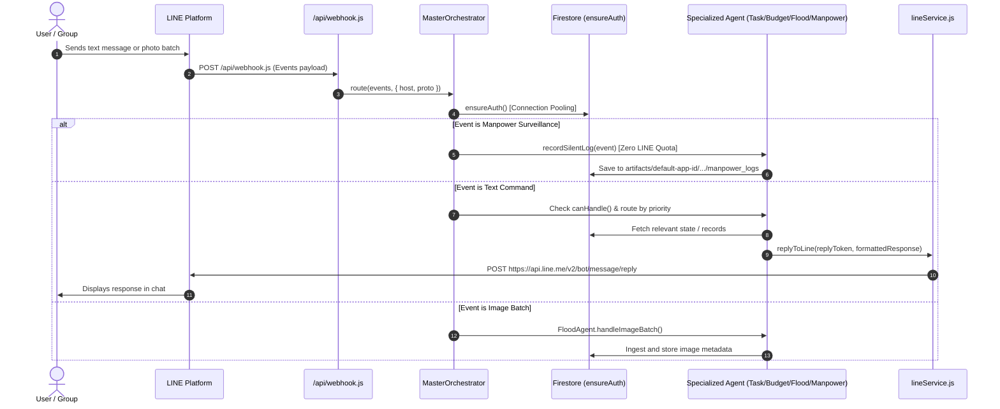
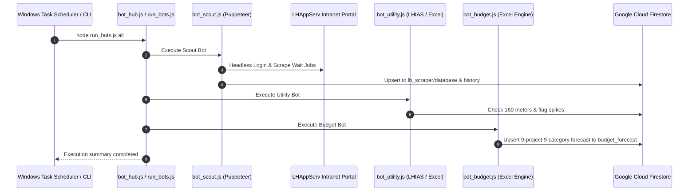

# Architecture Reference: LH Property & Infrastructure Maintenance

## 1. Component Boundaries & Responsibilities

| Component | Technology | Primary Location | Key Function |
| :--- | :--- | :--- | :--- |
| **Web Client Dashboard** | React 19, Vite, Tailwind | `lh-taskflow/src/` | Interactive management UI, Daily Tasks, Calendar, Kanban Billing, Team Status. |
| **Serverless Webhook** | Node.js ESM (Vercel) | `lh-taskflow/api/webhook.js` | Receives LINE OA webhook requests and proxies them to MasterOrchestrator. |
| **Multi-Agent Orchestrator** | Node.js ESM | `lh-taskflow/api/_agents/orchestrator.js` | Prioritized routing, text cleaning, connection pooling. |
| **TaskAgent** | Node.js ESM | `lh-taskflow/api/_agents/taskAgent.js` | Daily task status, 3-day WO countdown, pending job inspection. |
| **BudgetAgent** | Node.js ESM | `lh-taskflow/api/_agents/budgetAgent.js` | 9-category accounting breakdown, YTD/YTG calculations, overrun alerts. |
| **FloodAgent** | Node.js ESM | `lh-taskflow/api/_agents/floodAgent.js` | Hydrology telemetry, photo batching, Gemini Vision inference, PDF compilation. |
| **ManpowerAgent** | Node.js ESM | `lh-taskflow/api/_agents/manpowerAgent.js` | Passive contractor headcount surveillance with zero LINE quota cost. |
| **5 Scraper Bots Guild** | Node.js CJS, Puppeteer | `lh-scraper/bots/` | Headless scraping of intranet portals (LHAppServ, LHIAS) and workbook parsing. |
| **ChangTuen Service** | Google Apps Script | `gas-project/` | Spreadsheet persistence, anti-spam email alerts, 17:30 overdue cron jobs. |
| **IoT Pump Monitoring** | Vanilla JS / Chart.js | `lh-iot-pump-monitoring/` | Stormwater, sewage lift, and WWTP pump status and electrical telemetry. |

---

## 2. Event Sequence & Execution Flow

### 2.1 LINE Webhook Ingestion Pipeline

### 2.2 Data Sync with LH Intranet Systems

